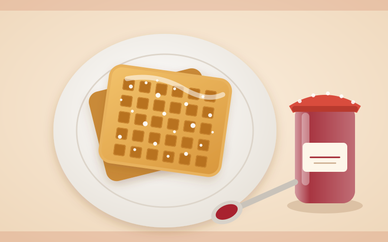
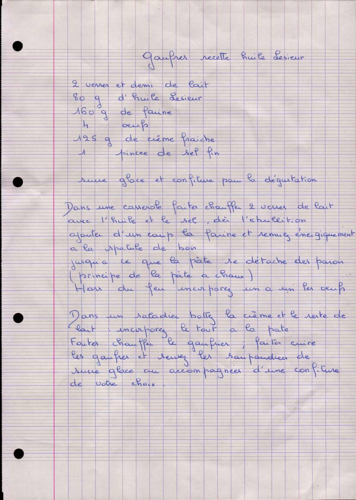

# Gaufres (recette huile Lesieur)

**Statut : À compléter** · Dessert

*Recette de Maman — Fiche manuscrite transmise par Maman*

Gaufres légères à base de pâte à choux, servies au sucre glace ou à la confiture.

## Ingrédients

- 2 verres et demi de lait (verre à moutarde, soit environ 50 cl)
- 80 g d'huile Lesieur
- 160 g de farine
- 4 œufs
- 125 g de crème fraîche
- 1 pincée de sel fin
- Sucre glace et confiture, pour la dégustation

## Préparation

1. Dans une casserole, faites chauffer 2 verres de lait (environ 40 cl) avec l'huile et le sel.
2. Dès l'ébullition, ajoutez d'un coup la farine et remuez énergiquement à la spatule en bois jusqu'à ce que la pâte se détache des parois (principe de la pâte à choux).
3. Hors du feu, incorporez les œufs un à un.
4. Dans un saladier, battez la crème avec le reste du lait (le demi-verre, environ 10 cl), puis incorporez le tout à la pâte.
5. Faites chauffer le gaufrier et faites cuire les gaufres.
6. Servez-les saupoudrées de sucre glace ou accompagnées d'une confiture de votre choix.

## Notes

*Précisions ajoutées lors de la transcription.*

- Le lait s'utilise en deux fois : 2 verres dans la casserole, le demi-verre restant battu avec la crème.
- « Verre » = verre à moutarde (environ 20 cl).

## À compléter

- [ ] Noter le nombre de gaufres obtenues lors de la prochaine réalisation.
- [ ] Noter le temps de cuisson au gaufrier.

## Fiche d'origine

Afficher le scan

---

Import Mealie : [`mealie.json`](mealie.json)

Transcrite le 2026-11-01. Fichier source : `recette.yaml`.
