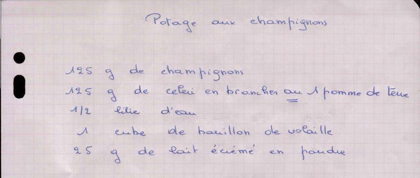

# Potage aux champignons

**Statut : À compléter** · Cuisson 30 min · Soupe

*Recette de Maman — Fiche manuscrite transmise par Maman (recto, avec le potage tomates-carottes)*

Potage léger aux champignons et céleri, lié au lait écrémé en poudre.

## Ingrédients

- 125 g de champignons
- 125 g de céleri en branches, ou 1 pomme de terre
- 1/2 litre d'eau (50 cl)
- 1 cube de bouillon de volaille
- 25 g de lait écrémé en poudre

## Préparation

1. Nettoyez et émincez les champignons. Lavez et coupez le céleri en tronçons (ou épluchez et coupez la pomme de terre en dés).
2. Portez l'eau à ébullition avec le cube de bouillon de volaille.
3. Ajoutez les légumes et laissez cuire 20 à 30 min à feu doux, à couvert.
4. Hors du feu, ajoutez le lait en poudre et mixez jusqu'à obtenir un velouté lisse.
5. Goûtez et rectifiez l'assaisonnement si besoin (le cube est déjà salé).

## Notes

*Précisions ajoutées lors de la transcription.*

- La fiche ne comporte que la liste des ingrédients : les étapes ont été rédigées lors de la transcription, la méthode (mixé, 20 à 30 min de cuisson) a été confirmée.
- Le « ou » est souligné deux fois sur la fiche : céleri ou pomme de terre, au choix. Le céleri donne un potage plus léger, la pomme de terre un potage plus épais.
- Le lait écrémé en poudre apporte l'onctuosité d'un velouté sans crème.

## À compléter

- [ ] Nombre de portions (probablement 2 bols).

## Fiche d'origine

Afficher le scan

---

Import Mealie : [`mealie.json`](mealie.json)

Transcrite le 2026-11-01. Fichier source : `recette.yaml`.
