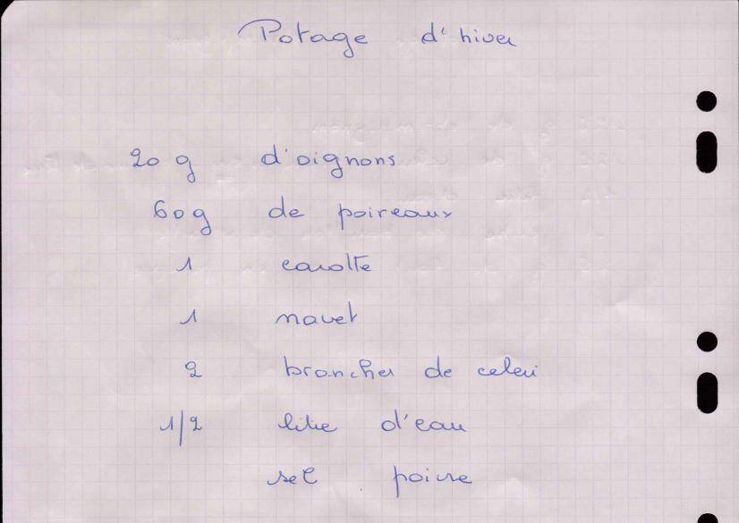

# Potage d'hiver

**Statut : À compléter** · Soupe

*Recette de Maman* — Fiche manuscrite transmise par Maman (verso de la fiche des potages champignons et tomates-carottes)

Potage de légumes d'hiver : poireau, carotte, navet et céleri.

## Ingrédients

- 20 g d'oignons
- 60 g de poireaux
- 1 carotte
- 1 navet
- 2 branches de céleri
- 1/2 litre d'eau (50 cl)
- Sel, poivre

## Préparation

1. Épluchez l'oignon, la carotte et le navet. Lavez soigneusement le poireau et le céleri.
2. Émincez l'oignon et le poireau, coupez la carotte, le navet et le céleri en dés.
3. Mettez les légumes dans l'eau froide salée, portez à ébullition puis laissez cuire 30 min à feu doux.
4. Mixez ou servez tel quel, poivré.

## Notes

*Précisions ajoutées lors de la transcription.*

- La fiche ne comporte que la liste des ingrédients : les étapes ont été proposées lors de la transcription.
- Les quantités sont petites : la recette correspond sans doute à 1 ou 2 bols. Elle se double facilement.

## À compléter

- [ ] Confirmer la méthode de préparation (mixé ou en morceaux ? temps de cuisson ?).
- [ ] Nombre de portions.

## Fiche d'origine

Afficher le scan

---

Import Mealie : [`mealie.json`](mealie.json)

Transcrite le 2026-11-01. Fichier source : `recette.yaml`.
