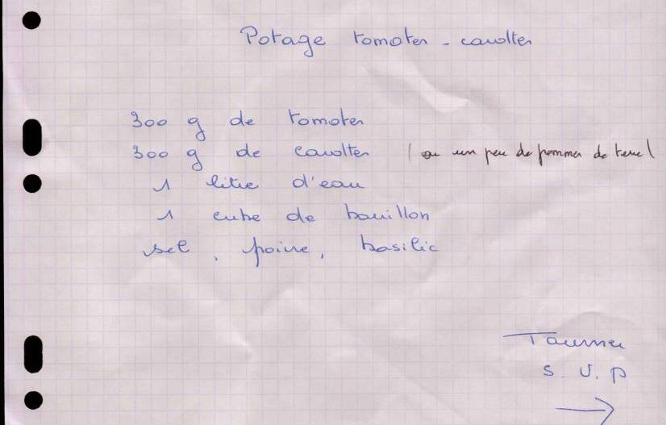

# Potage tomates-carottes

**Statut : À compléter** · Soupe

*Recette de Maman* — Fiche manuscrite transmise par Maman (recto, avec le potage aux champignons)

Potage de tomates et carottes au basilic.

## Ingrédients

- 300 g de tomates
- 300 g de carottes (on peut en remplacer une partie par un peu de pommes de terre)
- 1 litre d'eau
- 1 cube de bouillon
- Sel, poivre
- Basilic

## Préparation

1. Épluchez les carottes (et les pommes de terre si vous en remplacez une partie) et coupez-les en rondelles. Coupez les tomates en morceaux.
2. Portez l'eau à ébullition avec le cube de bouillon.
3. Ajoutez les légumes et laissez cuire 25 à 30 min à feu doux, jusqu'à ce que les carottes soient tendres.
4. Mixez, salez et poivrez.
5. Ajoutez le basilic ciselé au moment de servir.

## Notes

*Précisions ajoutées lors de la transcription.*

- La fiche ne comporte que la liste des ingrédients : les étapes ont été proposées lors de la transcription.
- Les pommes de terre remplacent une partie des carottes (le poids total de légumes reste le même) ; elles donnent un potage plus épais.
- Hors saison, des tomates pelées en conserve conviennent.

## À compléter

- [ ] Confirmer la méthode de préparation (mixé ? temps de cuisson ?).
- [ ] Nombre de portions (probablement 4 bols).

## Fiche d'origine

Afficher le scan

---

Import Mealie : [`mealie.json`](mealie.json)

Transcrite le 2026-11-01. Fichier source : `recette.yaml`.
