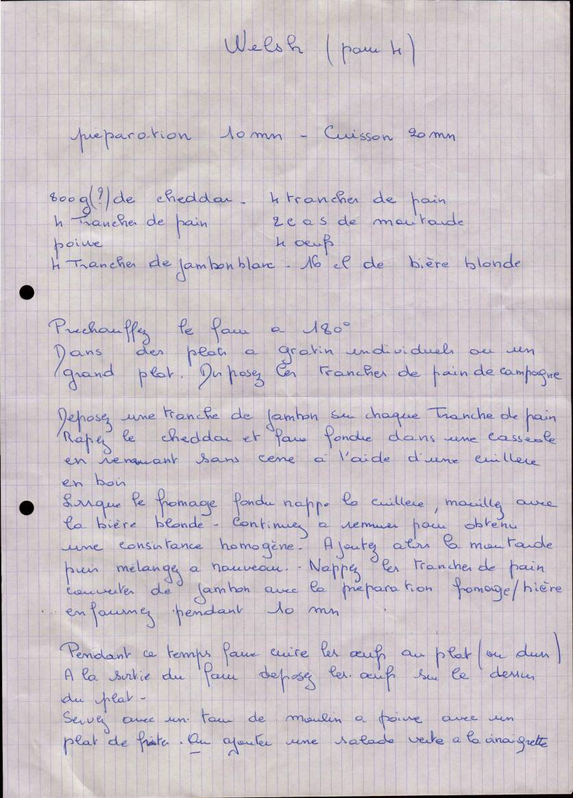

# Welsh

**Statut : Validée** · Pour 4 personnes · Préparation 10 min · Cuisson 20 min · Plat

*Recette de Maman — Fiche manuscrite transmise par Maman*

Welsh gratiné au cheddar et à la bière blonde, sur pain de campagne et jambon, avec un œuf au plat.

## Ingrédients

- 800 g de cheddar (quantité à ajuster, voir notes)
- 4 tranches de pain de campagne
- 4 tranches de jambon blanc
- 2 c. à soupe de moutarde
- 16 cl de bière blonde
- 4 œufs
- Poivre du moulin

## Préparation

1. Préchauffez le four à 180 °C.
2. Dans des plats à gratin individuels ou un grand plat, disposez les tranches de pain de campagne.
3. Déposez une tranche de jambon sur chaque tranche de pain.
4. Râpez le cheddar et faites-le fondre dans une casserole en remuant sans cesse à l'aide d'une cuillère en bois.
5. Lorsque le fromage fondu nappe la cuillère, mouillez avec la bière blonde. Continuez à remuer pour obtenir une consistance homogène.
6. Ajoutez alors la moutarde, puis mélangez à nouveau.
7. Nappez les tranches de pain couvertes de jambon avec la préparation fromage/bière et enfournez pendant 10 min.
8. Pendant ce temps, faites cuire les œufs au plat (ou durs).
9. À la sortie du four, déposez les œufs sur le dessus du plat.
10. Servez avec un tour de moulin à poivre et un plat de frites, ou une salade verte à la vinaigrette.

## Notes

*Précisions ajoutées lors de la transcription.*

- Cheddar : la fiche d'origine indique « 800 g (?) ». C'est la quantité d'un welsh copieux servi en plat unique (environ 200 g par personne). Avec des frites ou pour des appétits plus modestes, 150 g par personne (600 g pour 4) suffisent. Le fromage doit couvrir généreusement le pain.
- Choisir un cheddar affiné et le râper soi-même : le râpé en sachet contient de l'amidon et fond moins bien.
- Si la préparation épaissit trop, ajouter un trait de bière ; si elle est trop liquide, un peu de cheddar.
- La fiche indique « 4 tranches de pain » deux fois : 4 tranches retenues, une par personne.

## Fiche d'origine

Afficher le scan

---

Import Mealie : [`mealie.json`](mealie.json)

Transcrite le 2026-11-01. Fichier source : `recette.yaml`.
